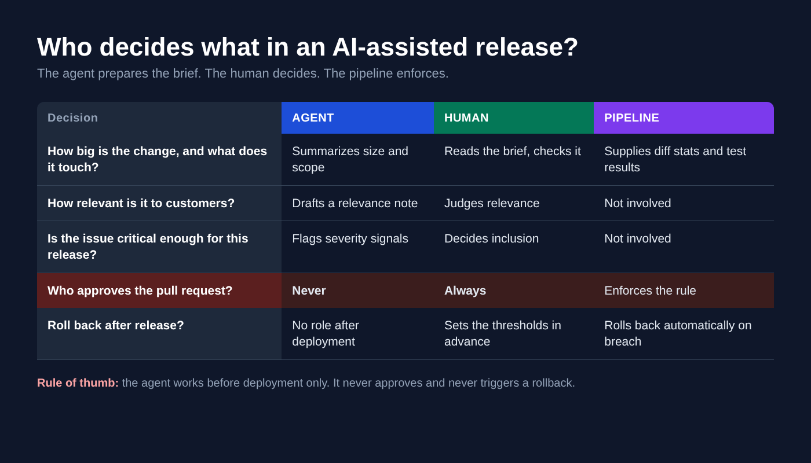

AI coding tools gave engineering teams more code. They did not give them more shipped software, and the gap now sits in the release process. Faros AI's 2026 report, based on about two years of telemetry from roughly 22,000 developers across more than 4,000 teams, compared each team's two lowest-AI-adoption quarters with its two highest ([Faros AI](https://www.faros.ai/research/ai-acceleration-whiplash)). At high adoption, task throughput per developer rose 33.7%, but deployments per week fell 11.7% and incidents per pull request rose 242.7%. Pull requests were 51% larger, and median time in PR review rose about 5x.

Two caveats from the report itself: the deployment figure comes from only about 10% of the dataset, and these are correlations, not proven causes.

If you manage releases, you have felt this. The queue grows, reviewers tire, and every change looks plausible.

This month the vendors started answering with agents of their own.

## What actually shipped

In July, AWS expanded its DevOps Agent into the delivery pipeline with two preview capabilities, pitched as an "AI-powered release engineer" ([InfoQ](https://www.infoq.com/news/2026/07/aws-devops-ai-agent/)):

### Release Readiness Review checks each change against production requirements, cross-repository dependencies and your engineering standards. Standards can be written in plain English instead of policy-as-code.

### Autonomous Release Testing writes a test plan per change, covering functional behavior, integration scenarios and regressions, and runs it in production-like environments you provision.

Results appear in GitHub and GitLab pull requests and in IDEs through Kiro and Claude Code. Engineers still approve changes before production.

On the supply-chain side, GitHub put a package firewall into public preview on October 20. It targets malware that runs during package install and steals CI credentials ([QA + AI Weekly Brief](https://qasimplifiedbyakash.substack.com/p/qa-ai-weekly-brief-oct-1623-2026)). That matters because your pipeline holds your most powerful secrets.

## Why I'm optimistic

Release work is mostly pattern recognition under time pressure: does this change touch a shared dependency, does it follow our standards, did anyone test the odd path. Those are jobs an agent can do on every pull request at 3 a.m., without fatigue. A human reviewer reading their fortieth diff of the day cannot.

The promise is not fewer people. It is people spending attention where judgment matters.

## Where I'd draw the line

An agent that grades its own team's work needs boundaries. Here is the split I'd defend:

The last row is the important one. An agent can recommend, but it should not hold the approval key for its own output.

## What I'd do this quarter

Here is what I plan to do next. It is a to-do, not something running today. Right now, release approval is manual: as release manager, I approve pull requests by judging how big the change is, how relevant it is to our customers, and whether the issue is critical enough to make the release. I'm going to build an agent that prepares that brief for each pull request, covering size, what the change touches, customer relevance and criticality. Then I'll check its output against my own decisions before I trust it with anything.

The agent's job ends before deployment. It helps me decide which pull requests get approved, and once the release is out it has no say. After release, rollback runs on hard metrics, and that decision belongs to the thresholds, never to the agent. Once the agent is running, I'll track how often its brief matched my final call, and how many approved changes caused rework or incidents, before I widen its remit.

The release manager role does not disappear. It moves up a level: from checking every change to owning the policy that decides how every change is checked.

*Both AWS capabilities are in preview, so expect rough edges and verify current availability before you plan around them.*
